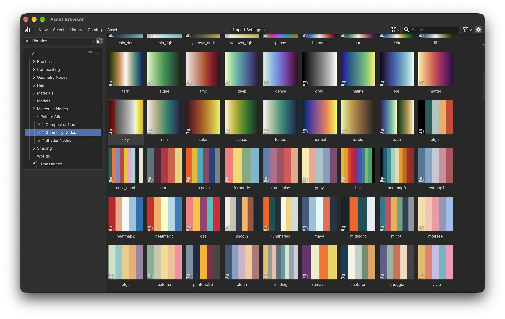
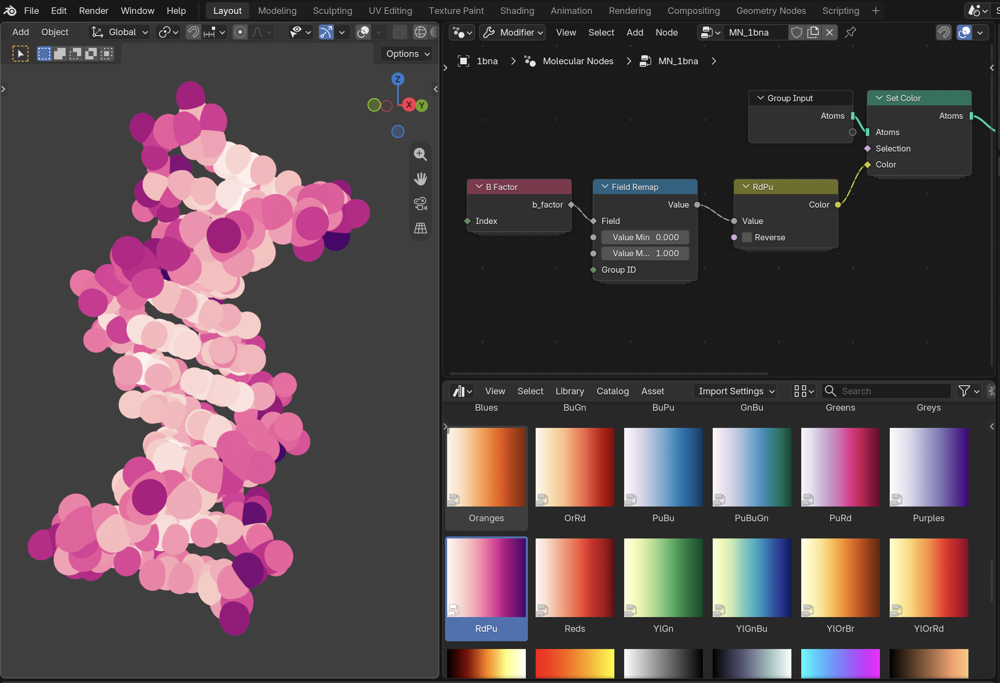
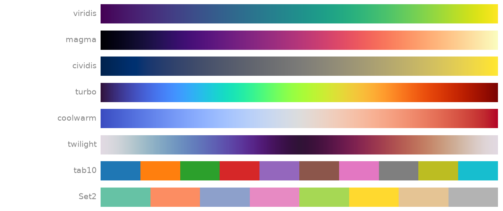
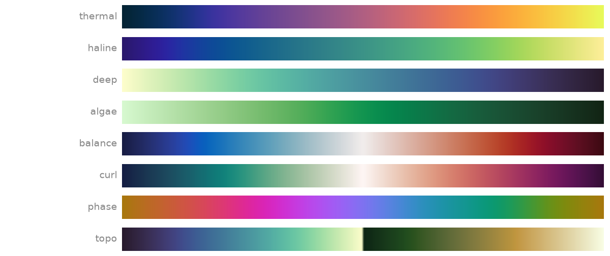
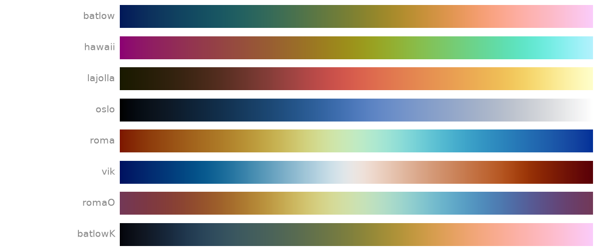
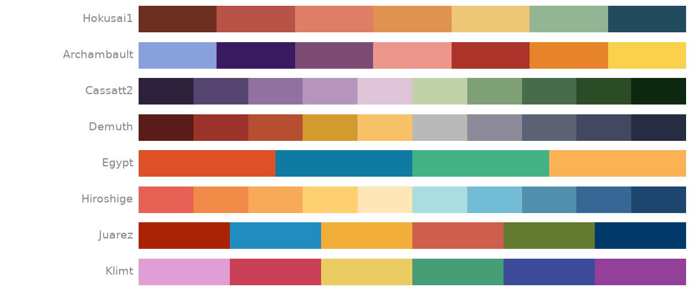
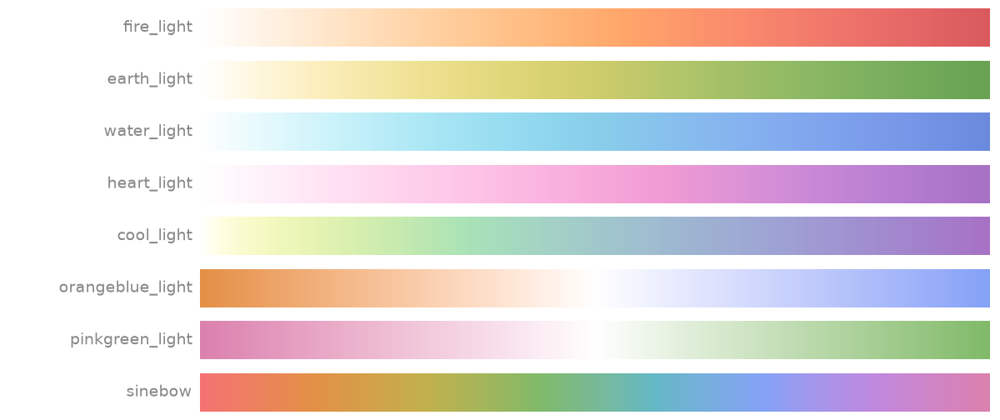
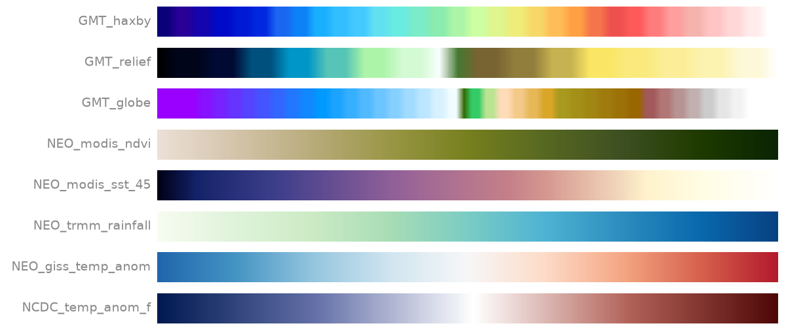
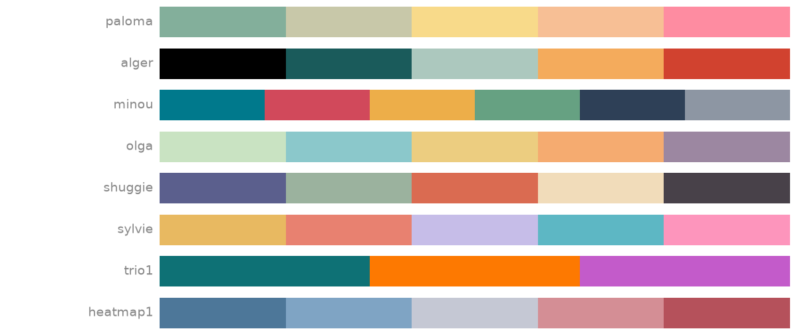
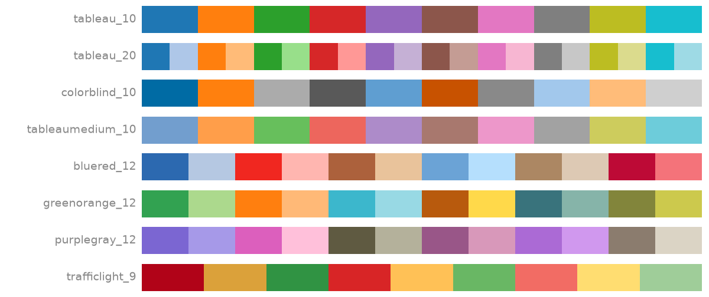

# Palette Atlas

Scientific and data visualisation colour palettes as a remote asset library for Blender 5.3+.

The palette nodes are created using [`nodebpy`](https://github.com/BradyAJohnston/nodebpy) and packaged into an online asset library. Each palette is one node group per editor (Geometry,
Shader and Compositor), returning a `Color`:

- **Smooth palettes**, such as `viridis`, take a `Value` from 0 to 1, and `Reverse`.
- **Discrete palettes**, such as `tab10` and every MetBrewer and LTC palette, also
  take an `Index` and a `Mode`: `Stepped` bands along `Value` (the default), a
  `Smooth` blend of the colours, or the colour at `Index`, wrapping around.

Assets are catalogued as `Palette Atlas/<editor>/<collection>/<category>`,
using each source's own categories (matplotlib's gallery sections, Crameri's
classes, CarbonPlan's types, Panoply's table groups for NASA, and cmocean's
descriptions). MetBrewer, LTC and Tableau have none and stay at the collection;
MetBrewer's colourblind-friendly palettes are tagged `Colorblind-Friendly`.





See the [gallery](#gallery) for examples from each collection, and
[sources](#sources) for where each comes from.

## Installation

Add this URL as a remote asset library in Blender:

```
https://bradyajohnston.github.io/palette-atlas
```

## Gallery

A few palettes from each collection, drawn from their source colours. Regenerate
these with `uv run scripts/swatches.py`.

### [matplotlib](#sources)



### [cmocean](#sources)



### [Scientific colour maps](#sources)



### [MetBrewer](#sources)



### [CarbonPlan](#sources)



### [NASA](#sources)



### [LTC](#sources)



### [Tableau](#sources)



## Sources

| Collection | Original source | Obtained via |
| --- | --- | --- |
| matplotlib | [matplotlib colormap reference](https://matplotlib.org/stable/users/explain/colors/colormaps.html) | [`matplotlib`](https://pypi.org/project/matplotlib/) |
| cmocean | [cmocean](https://matplotlib.org/cmocean/) | [`cmocean`](https://pypi.org/project/cmocean/) |
| Scientific colour maps | [Fabio Crameri](https://www.fabiocrameri.ch/colourmaps/) | [`cmcrameri`](https://pypi.org/project/cmcrameri/), plus `naviaW` from [Blender-Colormaps](https://github.com/TheJeran/Blender-Colormaps) |
| MetBrewer | [MetBrewer](https://github.com/BlakeRMills/MetBrewer) | [`met-brewer`](https://pypi.org/project/met-brewer/) |
| CarbonPlan | [carbonplan/colormaps](https://github.com/carbonplan/colormaps) | [`@carbonplan/colormaps`](https://www.npmjs.com/package/@carbonplan/colormaps) 4.0.0, exported by `scripts/carbonplan/` |
| NASA | [Panoply colour tables](https://www.giss.nasa.gov/tools/panoply/colorbars/) | [Blender-Colormaps](https://github.com/TheJeran/Blender-Colormaps) |
| LTC | [ltc-color-palettes](https://github.com/loukesio/ltc-color-palettes) | [Blender-Colormaps](https://github.com/TheJeran/Blender-Colormaps) |
| Tableau | [colormaps](https://pratiman-91.github.io/colormaps/docs/collections/tableau), which Blender-Colormaps credits, not Tableau itself | [Blender-Colormaps](https://github.com/TheJeran/Blender-Colormaps) |


## Palettes

Ramps hold sRGB colours and blend them in sRGB, as the palettes' own packages do,
and each group converts its colour to linear at the end, as Blender expects. This
means the colour swatches on a ramp look washed out if you open a group.

Where matplotlib defines a palette exactly, the group follows that definition
rather than samples of it:

- **Formulas** (`gnuplot`, `rainbow`, `cubehelix`, `flag`, `prism`, `afmhot`, `ocean`,
  `gnuplot2`, `gist_heat`) are built from math nodes.
- **Colour lists and segments** (the ColorBrewer maps, `jet`, `hsv` and others) use
  matplotlib's own stops, where they fit in one ramp.

Every other palette is fitted. A Color Ramp holds at most 32 stops. Longer palettes
are fitted to fewer stops, and any that one ramp can't hold within 2/255 are split
across several ramps, chosen by `Value`, until they are within 1/255. Blender bakes
ramps to 256 steps in the Shader and Compositor editors, so there a band edge can
move by up to 1/256 of the range, and the sharpest turns in a palette are slightly
rounded off.

Vendored tables are described in `src/palette_atlas/data/rgb/README.md`.


## Building

Some of the palettes can be expressed with a easy forula, and others are manually picked.
For those that are manually picked and are gradients, we can do some curve fitting to reduce
the number of points on a `Color Ramp` node that are required to express the palette (the 
node also is limited to 32 points). The results are cached and we use those points
for generating the reuslting nodes.

1. **Fit** palettes to Color Ramps. The result is cached in
   `src/palette_atlas/data/ramps/`, and only palettes that changed are refitted.

   ```sh
   uv run palette-atlas fit [collection ...]
   ```

2. **Build** the `.blend` files, catalogs and thumbnails into `library/`. This runs
   inside Blender and needs `nodebpy` available to Blender's Python.

   ```sh
   blender -b --factory-startup --python-exit-code 1 \
       -P src/palette_atlas/build.py -- [collection ...]
   ```

3. **Index** the library.

   ```sh
   blender -c asset_listing generate library
   ```

4. **Verify** the built groups in every editor against the source palettes. This
   runs Blender itself, from `--blender` or `$BLENDER`.

   ```sh
   uv run palette-atlas verify [collection ...] --blender /path/to/blender
   ```

5. **Package** the extension. It holds only `extension/blender_manifest.toml`,
   which points Blender at the library hosted on GitHub Pages, so keep its
   `version` in step with `pyproject.toml`.

   ```sh
   mkdir -p dist
   blender -c extension build --source-dir extension --output-dir dist
   ```

## Licence

The node group assets in the library are marked `CC0-1.0`. The code that builds
them is GPL-3.0-or-later, in `LICENSE`. The palettes themselves come from the
projects listed in [sources](#sources), each under its own terms.
